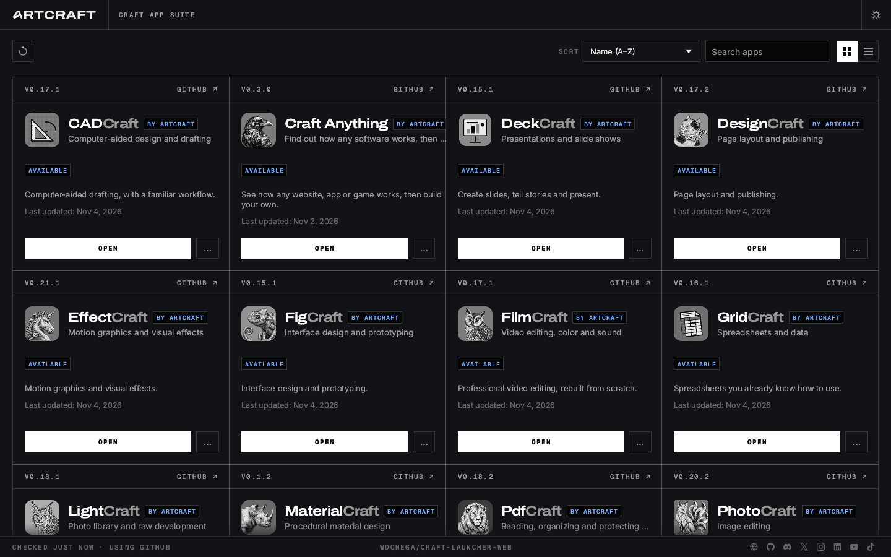
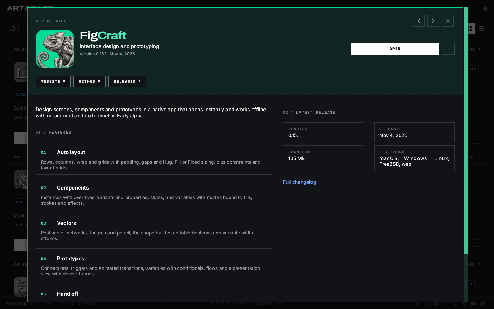
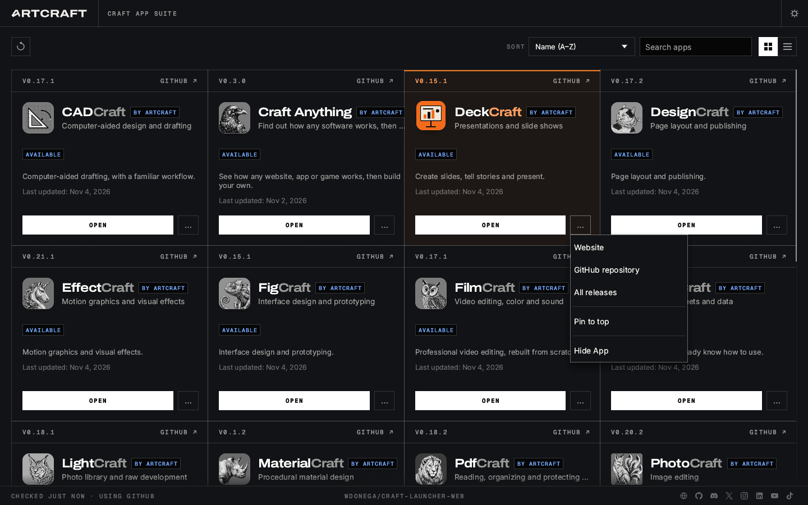
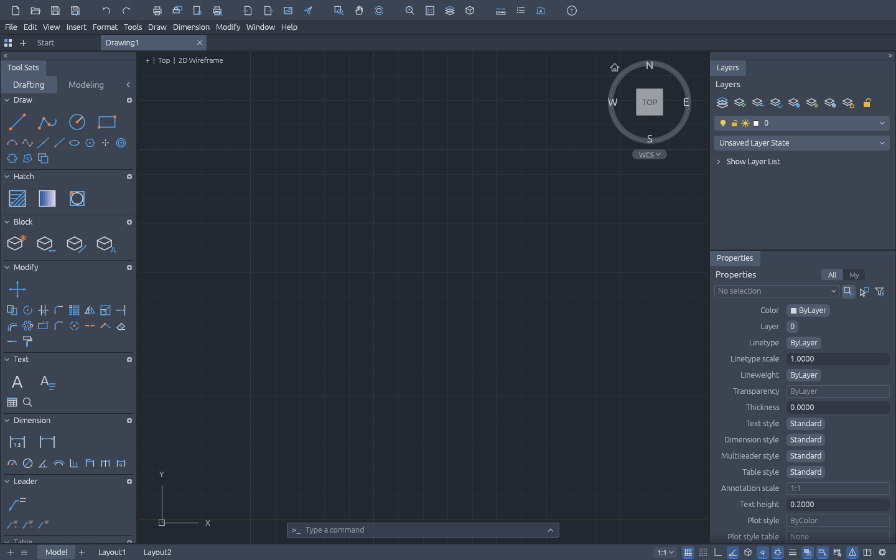

# craft-launcher-web

**The whole [Craft App Suite](https://getartcraft.com) in your browser, served from your own machine.**
One script fetches the web build of every Craft app, puts the [ArtCraft Launcher](https://github.com/storytold/craft-launcher)
in front of them, and serves it all from a single URL. Open the launcher at `/`, click **Open**, and
the app runs at `/fig/`, `/photo/`, `/cad/`, and so on.



```sh
docker run --rm -p 8080:80 ghcr.io/wdonega/craft-launcher-web:latest
# then open http://localhost:8080/
```

---

## Why this exists

Every Craft app publishes a **web version** with its GitHub release: a static site
(`<app>-web-<version>.zip`, WebAssembly plus a little JavaScript). But there are 17 apps, each in its
own repository, each with its own release cadence. Running them locally means doing this for
**each one**:

1. find the repository and its latest release,
2. download the web zip,
3. unzip it somewhere sensible,
4. serve it over HTTP with the right MIME type for `.wasm` (opening `index.html` from disk won't work),

and then repeating all of that every time an app ships a new version. The official launcher's web
build doesn't help here: it lists the apps and offers the *desktop* downloads.

**craft-launcher-web does all of it in one step.** `build.py` reads the app catalog straight from the
launcher's source, downloads every web build, lays them out under one site, and patches the launcher
so each card **opens** the local web app instead of downloading an installer. The result is one
folder (or one Docker image) that runs the entire suite on `localhost`, offline.

## The apps

| | App | Path | What it does | Source |
|---|---|---|---|---|
|  | **PhotoCraft** | [`/photo/`](http://localhost:8080/photo/) | Image editing | [storytold/photocraft](https://github.com/storytold/photocraft) |
|  | **VectorCraft** | [`/vector/`](http://localhost:8080/vector/) | Vector illustration | [storytold/vectorcraft](https://github.com/storytold/vectorcraft) |
|  | **FilmCraft** | [`/film/`](http://localhost:8080/film/) | Video editing, color and sound | [storytold/filmcraft](https://github.com/storytold/filmcraft) |
|  | **LightCraft** | [`/light/`](http://localhost:8080/light/) | Photo library and raw development | [storytold/lightcraft](https://github.com/storytold/lightcraft) |
|  | **PdfCraft** | [`/pdf/`](http://localhost:8080/pdf/) | Reading, organizing and protecting PDFs | [storytold/pdfcraft](https://github.com/storytold/pdfcraft) |
|  | **EffectCraft** | [`/effect/`](http://localhost:8080/effect/) | Motion graphics and visual effects | [storytold/effectcraft](https://github.com/storytold/effectcraft) |
|  | **DesignCraft** | [`/design/`](http://localhost:8080/design/) | Page layout and publishing | [storytold/designcraft](https://github.com/storytold/designcraft) |
|  | **FigCraft** | [`/fig/`](http://localhost:8080/fig/) | Interface design and prototyping | [storytold/figcraft](https://github.com/storytold/figcraft) |
|  | **WordCraft** | [`/word/`](http://localhost:8080/word/) | Writing and document design | [storytold/wordcraft](https://github.com/storytold/wordcraft) |
|  | **SoundCraft** | [`/sound/`](http://localhost:8080/sound/) | Recording, editing and mixing audio | [storytold/soundcraft](https://github.com/storytold/soundcraft) |
|  | **DeckCraft** | [`/deck/`](http://localhost:8080/deck/) | Presentations and slide shows | [storytold/deckcraft](https://github.com/storytold/deckcraft) |
|  | **CADCraft** | [`/cad/`](http://localhost:8080/cad/) | Computer-aided design and drafting | [storytold/cadcraft](https://github.com/storytold/cadcraft) |
|  | **GridCraft** | [`/grid/`](http://localhost:8080/grid/) | Spreadsheets and data | [storytold/gridcraft](https://github.com/storytold/gridcraft) |
|  | **TextureCraft** | [`/texture/`](http://localhost:8080/texture/) | 3D texture painting | [storytold/texturecraft](https://github.com/storytold/texturecraft) |
|  | **MaterialCraft** | [`/material/`](http://localhost:8080/material/) | Procedural material design | [storytold/materialcraft](https://github.com/storytold/materialcraft) |
|  | **Craft Anything** | [`/anything/`](http://localhost:8080/anything/) | Find out how any software works, then craft your own | [storytold/craft-anything](https://github.com/storytold/craft-anything) |
|  | **SolidCraft** | [`/solid/`](http://localhost:8080/solid/) | Parametric 3D CAD | [tangency-labs/solidcraft](https://github.com/tangency-labs/solidcraft) |

The path is the bold half of the app's wordmark, lowercased (**Fig**Craft → `/fig/`). The list
follows the launcher's catalog: when an app is added there, the next build picks it up.

## Screenshots

| App details: **Open** instead of *Download for macOS* | The `…` menu, trimmed for the web |
|---|---|
|  |  |

CADCraft running at `/cad/`, straight from the launcher:



## Quick start

**Docker** (nothing else needed):

```sh
docker run --rm -p 8080:80 ghcr.io/wdonega/craft-launcher-web:latest
```

**Docker Compose**, pinned to a launcher version:

```sh
CRAFT_LAUNCHER_VERSION=0.14.1 docker compose up -d     # omit the variable for :latest
```

**From source**:

```sh
brew install trunk && rustup target add wasm32-unknown-unknown   # to build the patched launcher
python3 build.py                                                  # fills site/ (about 320 MB of downloads)
python3 serve.py                                                  # http://localhost:8080/
# or: docker compose up -d --build
```

`localhost` is a secure context, so WebGPU and the clipboard work. To serve it from another host, put
it behind HTTPS; over plain HTTP the apps fall back to WebGL2.

## How it works

```
storytold/craft-launcher ──► catalog.rs (ids, names, descriptions, repos) + app icons
        │                    launcher source at the release tag ──► patch ──► trunk build
        ▼
each app's latest GitHub release ──► <app>-web-<version>.zip ──► site/<path>/
        ▼
site/
├── index.html            the launcher
├── fig/  photo/  cad/ …  one folder per app, as published
└── _local/
    ├── shim.js           loaded first by every page
    ├── apps.json         the catalog this site was built from
    ├── releases/         the release data the launcher would ask GitHub for
    └── screenshots/      the pictures in the launcher's app details
```

`_local/shim.js` is what turns stock web builds into one local site:

- **Offline.** The launcher's calls to the GitHub releases API and its screenshot downloads are
  answered from `_local/`, so the site needs no network once it's built.
- **Open, not download.** A click on an app's download link opens the local `/<path>/` instead.
- **No settings clash.** Every app lives on the same origin, so `localStorage` gets a namespace per
  app. Settings saved by one app don't overwrite another's.

### Changes to the launcher

The launcher is built from its own source at the release tag with
[`patches/launcher-web.patch`](patches/launcher-web.patch), which only touches `crates/ui-egui/src/views.rs`:

- the main button on every card and in the app details says **Open** (already translated in all of
  the launcher's languages) instead of *Download for macOS*;
- the `…` menu drops *Choose version*, *Release notes* and the per-format downloads (*Disk image*, …),
  since there is exactly one local version of each app;
- the footer shows a link to this repository, centred.

If the patch stops applying to a newer launcher, `build.py` says so and falls back to the stock web
zip from the release. `--require-patch` makes that an error instead, which is what the release
workflow uses.

## Versions

This project has the **same version as the launcher it ships**:

| craft-launcher | craft-launcher-web | image |
|---|---|---|
| `v0.14.1` | release `v0.14.1` | `ghcr.io/wdonega/craft-launcher-web:0.14.1` |

[`.github/workflows/release.yml`](.github/workflows/release.yml) checks every day for a new
craft-launcher release. When there is one, it builds the site, publishes the image (tagged with the
version and `latest`) and creates the matching release, listing the version of every app
in it. Run it by hand from the *Actions* tab to rebuild an existing version after apps ship updates
(*force*), or to build an older launcher tag.

The image is built for every platform `nginx:alpine` supports: `linux/amd64`, `linux/arm64/v8`,
`linux/arm/v7`, `linux/arm/v6`, `linux/386`, `linux/ppc64le`, `linux/riscv64` and `linux/s390x`. The site
is the same static files for all of them.

Locally: `python3 build.py --launcher-tag v0.14.1` (default: the latest).

## Updating

```sh
python3 build.py && docker compose up -d --build
```

Only the zips that changed are downloaded again (`cache/` keeps the rest), and the launcher recompiles
in under a minute unless its version changed. The new site is assembled next to the old one and only
replaces it at the end, so a failed build leaves the current site untouched.

## Project layout

| File | Purpose |
|---|---|
| `build.py` | Fetches the catalog and every web build, builds the patched launcher, writes `site/` |
| `shim.js` | Offline release data, Open → local app, per-app `localStorage` |
| `patches/launcher-web.patch` | The launcher changes listed above |
| `serve.py` | Small static server with the right MIME types, for use without Docker |
| `Dockerfile`, `nginx.conf` | `nginx:alpine` image serving `site/` (gzip, `application/wasm`, cache headers) |
| `compose.yaml` | Runs the published image, or builds it locally |
| `.github/workflows/release.yml` | One release and image per craft-launcher release |

`site/` and `cache/` are generated and not committed.

## Credits

Everything that runs here is the work of the projects below. This repository only downloads, arranges
and serves their published builds.

- **[ArtCraft Launcher](https://github.com/storytold/craft-launcher)** by ArtCraft: the launcher UI,
  the app catalog and the app icons. The screenshots in the app details come from
  [storytold/craft-launcher-assets](https://github.com/storytold/craft-launcher-assets).
- **[The Craft App Suite](https://getartcraft.com)** by ArtCraft: every app in the table above.
- **[SolidCraft](https://solidcraft.io)** by Tangency Labs, a community app in the launcher's catalog.

This project is not affiliated with or endorsed by ArtCraft or Tangency Labs.

## License

Like the launcher and the apps it serves, craft-launcher-web is licensed under either of

- [Apache License, Version 2.0](LICENSE-APACHE)
- [MIT License](LICENSE-MIT)

at your option. Take it and do whatever you like with it.

The downloaded web builds keep their own licence files (MIT and Apache-2.0), shipped as published in
each app's folder.
